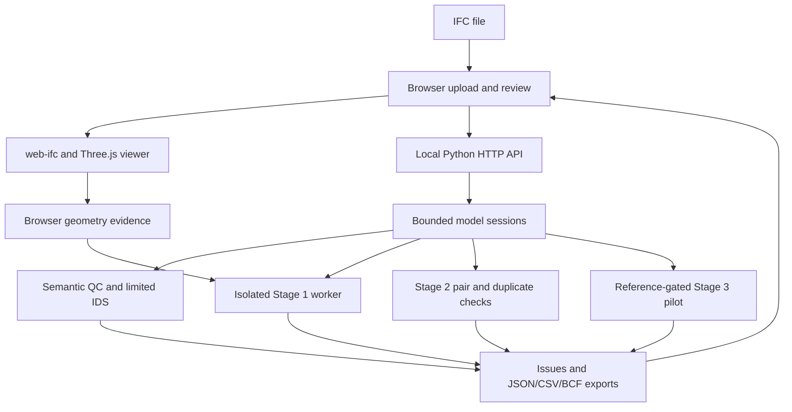

# Architecture

This document describes the implementation in application v0.7.16. The planned production stack is documented separately in [Roadmap](ROADMAP.md).

## Data flow

The browser uploads the model once to `POST /api/models`. The API streams bytes into a temporary IFC file, computes SHA-256 and returns a model ID plus semantic analysis. Later operations refer to that ID. The browser retains the original file for its independent WASM extraction and viewer.

## Modules

| Location | Responsibility |
| --- | --- |
| `server.py` | Static files, JSON/multipart request validation, model sessions, job polling, API capability reporting and exports |
| `web/app.js` | Upload and analysis lifecycle, readiness gates, issue filters, model selection, review controls and exports |
| `web/viewer.js`, `web/render-batches.js` | IFC geometry loading, world/model coordinate transforms, spatial render batches, picking, highlight overlays, framing and rendering probes |
| `web/review-ledger.js`, `web/pair-comparison.js` | Model-specific review persistence, review-history repair and pair comparison presentation |
| `ifcqc/analyzer.py`, `semantic_rules.py`, `backends.py` | IfcOpenShell semantic traversal and QC rule execution |
| `ifcqc/ids_validator.py`, `parser.py` | Limited IDS/educational STEP-parser support; this is not a full IfcTester adapter |
| `ifcqc/runtime.py`, `geometry_worker.py` | Temporary model store, one-worker background jobs, caching, progress, cancellation, watchdogs and resource limits |
| `ifcqc/geometry_diagnostics.py`, `geometry_acceptance.py`, `geometry_evidence.py` | Stage 1 extraction measurements, analytic reference cases and cross-engine evidence |
| `ifcqc/geometry_checks.py`, `near_duplicates.py`, `duplicate_acceptance.py` | Stage 2 exact and translation-only near geometry candidates and reference controls; later experimental prototypes remain blocked in the released API |
| `ifcqc/element_comparison.py`, `opening_host_geometry.py` | Targeted property/geometry comparison and explicit opening-host bounds evidence |
| `ifcqc/hard_clashes.py`, `solid_intersection.py`, `hard_clash_acceptance.py` | Stage 3 MEP/structure pilot, Manifold volume intersection, convex SAT depth measurement and analytic controls |
| `ifcqc/legacy_hard_clash_probe.py` | Preserved earlier IfcOpenShell intersection behavior for the original 14/18 baseline |
| `ifcqc/bcf.py` | BCF 2.1 topic/component-viewpoint ZIP construction |

## Validation gates

1. **Stage 1 extraction evidence:** IfcOpenShell extracts world-space geometry and reports coverage, units, bounds, element IDs, area/volume diagnostics, timings and failures. Browser web-ifc supplies independently measured geometry evidence. Reference controls and explicit demo tolerances accompany the report.
2. **Stage 2 readiness:** Core extraction and complete browser STEP-ID/extent mapping must pass. An extent disagreement may remain in strict Stage 1 evidence while duplicate review is available. Completing a job alone is not a pass.
3. **Stage 3 pilot:** The frontend requires current-model readiness and passed known-answer controls; the server reruns the reference gate before scanning. Bounds exclude clearly separated pairs. Retained pairs use actual solid intersection. For supported convex bodies, the threshold metric is minimum translation to boundary contact, not the former kernel's protrusion distance.

Non-convex positive intersections retain their measured volume and an explicit depth **Not evaluated** finding. This makes the selected scope incomplete for threshold evaluation. An expected unknown-depth reference case can pass the matrix because unknown status was correctly retained; this does not validate an unknown numerical depth.

No stage establishes drawing completeness, author intent, site reality or project compliance without the relevant approved references. Candidates do not automatically modify IFC data.

## API map

| Method and route | Purpose |
| --- | --- |
| `GET /api/health`, `GET /api/capabilities` | Server health and dependency/capability state |
| `POST /api/models` | Streaming IFC upload and semantic analysis |
| `POST /api/models/{id}/analyze` | Reanalyse stored IFC using the selected QC profile |
| `POST /api/geometry-jobs` | Start isolated Stage 1 extraction using current browser evidence |
| `GET /api/geometry-jobs/{id}` | Job progress and final report |
| `POST /api/geometry-jobs/{id}/cancel` | Cancel a running extraction job |
| `GET /api/geometry-acceptance` | Known-answer Stage 1 matrix |
| `POST /api/geometry-checks` | Released Stage 2 duplicate checks; later prototype flags are rejected |
| `POST /api/compare-elements` | Targeted element fields, properties, dimensions and opening-host evidence |
| `GET /api/hard-clash-reference` | Stage 3 reference matrix and preserved original baseline |
| `GET /api/hard-clash-sample` | Compact synthetic pilot IFC |
| `POST /api/hard-clashes` | Reference-gated bounded model/subset hard-clash scan |
| `POST /api/validate-ids` | Supported IDS-subset validation |
| `POST /api/export-bcf` | Issue BCF export |

Legacy inline analysis/diagnostic endpoints exist for fixtures and compatibility; the browser's large-model path uses stored uploads and isolated jobs.

## Resource and state boundaries

- File size: 100 MiB. Local model store: up to three models and 250 MiB total, with protection for models used by running jobs.
- Stage 1: one concurrent spawned worker; size-aware 15/30/45-minute wall-clock budgets, 5/10/15-minute no-progress watchdogs, and a configured 4 GiB worker-memory ceiling where the platform supports enforcement. Timeouts are inconclusive, not a model defect.
- Evidence cache: current server session only, keyed by application version, model SHA-256 and browser geometry evidence. Restarting the server discards it.
- Stage 2 near search: bounded nearby pair tests/results with incomplete-scan reporting. The comparison is translation-only and triangulation dependent.
- Stage 3: 100 eligible bodies, 200,000 triangles, 2,500 retained pair tests; explicit STEP-ID subsets for larger models.
- Pair comparisons and Stage 3/reference operations share a server lock. Issue rendering is capped at 250 rows while full exports retain findings.
- Reviews: browser localStorage keyed to exact model SHA-256; exported JSON retains review notes/history. This is not a multi-user database or permanent model-version store.

## Coordinates and rendering

Backend bounds use IFC world coordinates in metres with IFC Z-up. Browser evidence publishes its coordinate frame; viewer model centring is accounted for in the evidence transforms. Opaque meshes share materials/source geometry and are merged into spatial batches. Triangle ranges retain STEP IDs for picking; selected elements use separate overlays. Transparent geometry remains sortable. Opening voids can use explicit host selection or bounds markers when no standalone solid is renderable.

## Data and deployment

Models are processed by the local Python server. The application has no authentication, tenancy or production persistence layer. Run it on loopback; public or shared deployment needs an intentional security architecture. Synthetic fixtures and existing diagnostic evidence ship with the repository; temporary uploaded source models are not part of it.
